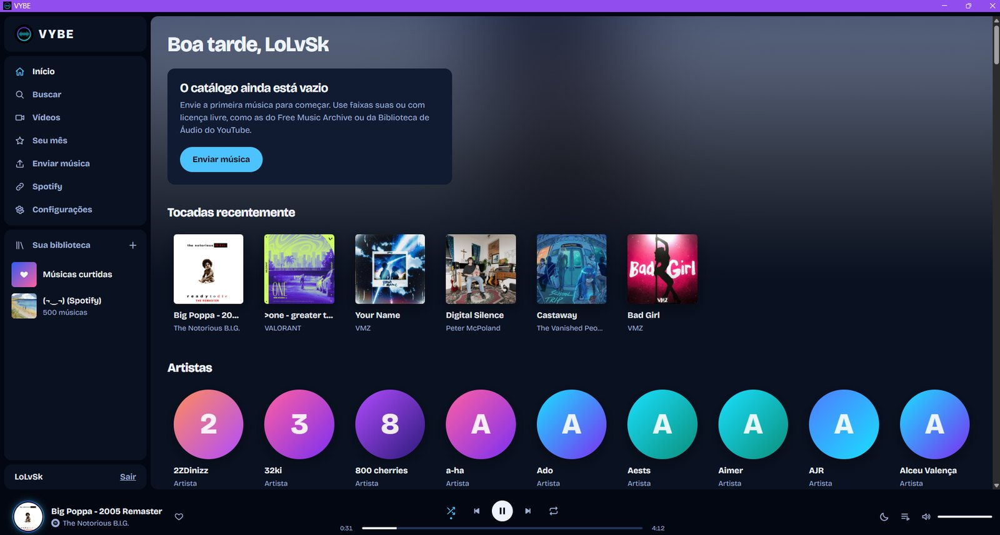
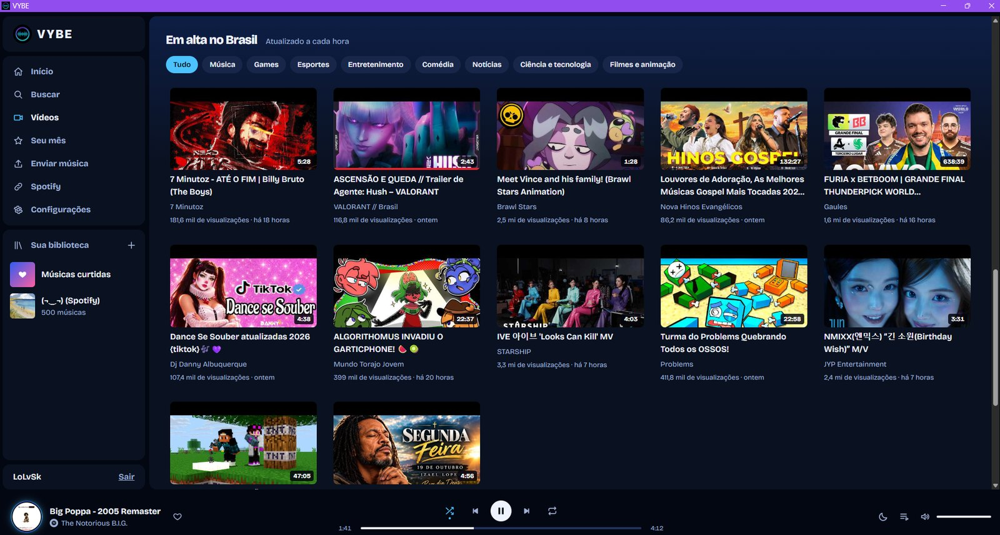
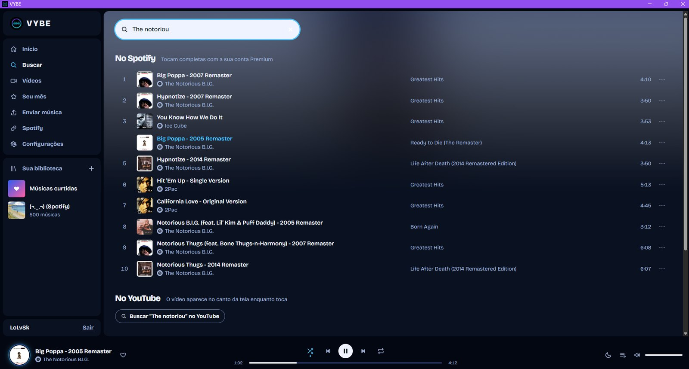
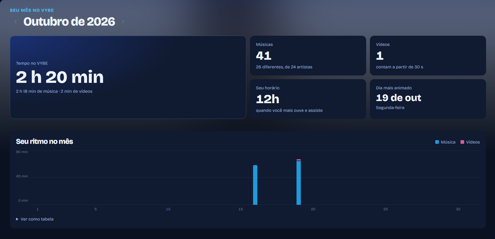
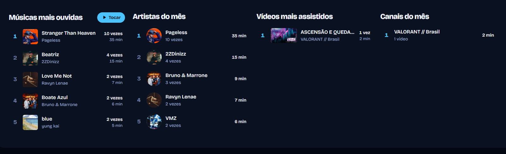
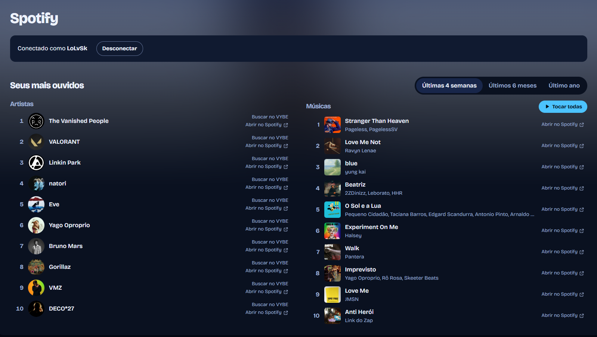
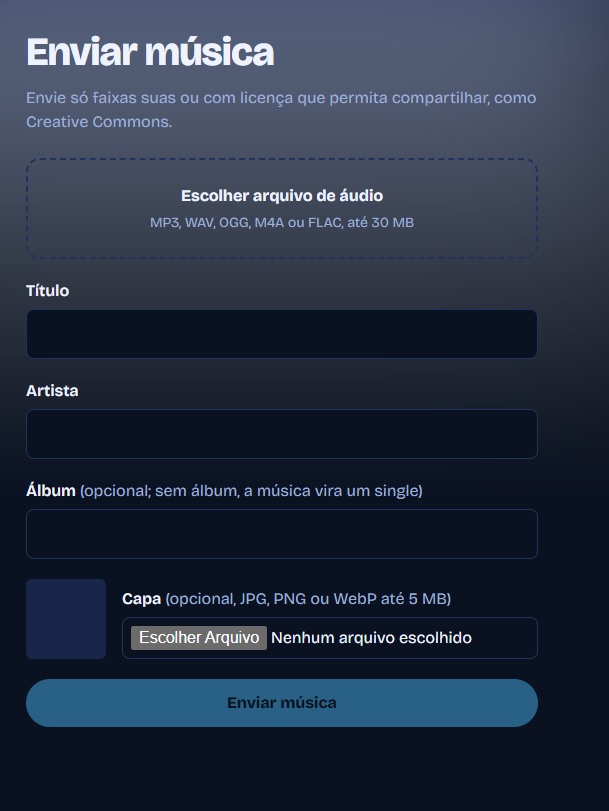
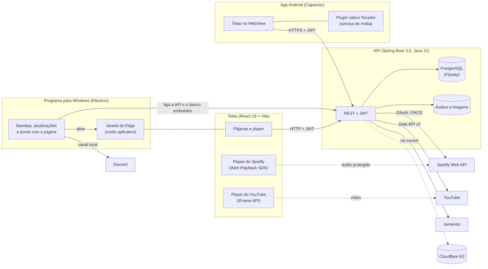

# VYBE

[](https://github.com/Cauan-Silva/vybe/releases/latest)
[](https://github.com/Cauan-Silva/vybe/releases/latest)
[](https://github.com/Cauan-Silva/vybe/actions/workflows/ci.yml)

App de música e vídeos feito do zero com Spring Boot e React: streaming por partes, um player que não para ao trocar de página, Spotify e YouTube integrados, um programa para Windows pensado para quem ouve e assiste enquanto joga e um app Android ligado a uma API hospedada.



> Use só músicas suas ou com licença que permita compartilhar (Creative Commons, Free Music Archive, Biblioteca de Áudio do YouTube).

## Baixar o programa (Windows)

1. Baixe o **VYBE-Setup** na [última versão](https://github.com/Cauan-Silva/vybe/releases/latest) e execute. Java e PostgreSQL já vêm dentro, não precisa instalar nada.
2. Se o Windows mostrar o aviso do SmartScreen (o instalador ainda não é assinado): **Mais informações → Executar assim mesmo**.
3. Crie sua conta e, em **Configurações**, informe as chaves que quiser usar. Todas são opcionais: Spotify (Client ID), YouTube (chave de API), Jamendo (Client ID) e Discord (ID do aplicativo). O passo a passo está na própria tela.

Depois disso, as versões novas chegam sozinhas. Detalhes do programa em [docs/PROGRAMA.md](docs/PROGRAMA.md).

## App Android

Baixe o **VYBE-x.y.z.apk** na [última versão](https://github.com/Cauan-Silva/vybe/releases/latest) pelo celular e abra o arquivo (o Android pede para permitir a instalação de apps baixados pelo navegador). O app usa a API hospedada online, então a conta é outra, separada da do programa para Windows, que guarda tudo no próprio computador.

- **"Tocando agora" em tela cheia:** toque na música na barra do player para ver a capa grande, a barra de tempo, todos os controles, o timer e a fila. O "voltar" do celular fecha a tela.
- **Tela apagada:** músicas enviadas e do Jamendo continuam tocando com a tela apagada, com notificação, controles na tela de bloqueio e nos botões do fone Bluetooth.
- **Spotify pelo YouTube:** no celular não há o player do Spotify, então a API acha o mesmo vídeo no YouTube (título, artista e duração) e ele toca no app. Pelas regras do YouTube, músicas do YouTube só tocam com o app aberto: ao sair, elas pausam.

Como o APK é gerado e assinado no GitHub Actions: [docs/APP.md](docs/APP.md). Como a API foi publicada (Render, Neon e Cloudflare R2): [docs/NUVEM.md](docs/NUVEM.md).

## O que tem aqui

### 🎵 Música
- **Streaming por partes (HTTP Range):** a música começa a tocar sem baixar o arquivo inteiro, e pular para qualquer ponto busca só aquele trecho
- **Player fixo** que continua tocando ao trocar de página, com aleatório, repetir, volume e um anel neon na capa que gira enquanto toca
- **Fila editável:** arrastar para reordenar, subir e descer, tirar, limpar e "Tocar a seguir"
- **Timer para dormir:** pausa depois de 15 a 90 minutos ou no fim da música
- **Spotify:** login (OAuth, com PKCE no programa), artistas e músicas mais ouvidos, importação de playlists, busca no catálogo inteiro e, com Premium, as músicas tocam completas no player do VYBE (Web Playback SDK)
- **YouTube:** busca de músicas que tocam no player oficial, numa janelinha no canto da tela
- **Catálogo Creative Commons do Jamendo** e **envio das suas músicas**, com capa, álbum e barra de progresso
- **Curtidas, playlists e tocadas recentemente**, com cadastro e login (JWT)

### 📺 Vídeos
- **Qualquer vídeo do YouTube:** em alta no Brasil por categoria, busca, página do canal, "Assistir depois", histórico e continuar de onde parou
- **Feito para você:** *Para você* (vídeos novos dos canais que você mais assiste), *Inscrições* (siga canais) e *Seus interesses* (até 3 temas, como "valorant")
- **Janela flutuante** (Picture-in-Picture) que fica por cima de tudo e continua enquanto você navega pelo VYBE
- **Luz ambiente** em volta do player, que acompanha as cores do vídeo em tempo real no programa

### 🎮 Para quem joga
- **Teclas de mídia e painel de mídia do Windows**, também nas músicas do Spotify e do YouTube, com o jogo em primeiro plano
- **Discord Rich Presence:** "Ouvindo VYBE" no perfil, com capa e tempo da música
- **Atalhos de teclado:** Espaço/K, setas (5 s e volume), Shift+setas, M, S, R e Ctrl+K
- **Programa leve:** Java enxuto, banco com pouca memória, modo leve sem animações e quase nada rodando com a janela minimizada
- **Atualização automática** pelas Releases do GitHub

### ✨ Do seu jeito
- **Perfil** com foto, banner, frase e as músicas e artistas mais ouvidos (do mês ou de sempre)
- **Seu mês no VYBE:** resumo estilo Wrapped com tempo ouvido e assistido, rankings e o ritmo de cada dia
- **Temas:** Neon, Aurora, Oceano, Pôr do sol, Claro e **Personalizado**, em que você arrasta o destaque, a cor secundária e o fundo numa roda de cores (do centro cinza, sem cor, até a borda mais viva)
- **Luz dinâmica** (o topo da página ganha as cores da capa que está tocando), texto maior e layout responsivo, com navegação inferior no celular

## Telas

<table>
  <tr>
    <td></td>
    <td></td>
  </tr>
  <tr>
    <td align="center">Aba Vídeos</td>
    <td align="center">Busca no Spotify e no YouTube</td>
  </tr>
  <tr>
    <td></td>
    <td></td>
  </tr>
  <tr>
    <td align="center">Seu mês no VYBE</td>
    <td align="center">Rankings do mês</td>
  </tr>
  <tr>
    <td></td>
    <td align="center"></td>
  </tr>
  <tr>
    <td align="center">Mais ouvidos no Spotify</td>
    <td align="center">Enviar música</td>
  </tr>
</table>

## Arquitetura



Online, a API roda num contêiner Docker no Render, o banco é um PostgreSQL do Neon e os áudios e imagens ficam no Cloudflare R2 (o navegador baixa direto de lá). No programa, a API e o PostgreSQL rodam no próprio computador. As telas abrem numa janela do Edge porque o player do Spotify exige a proteção de conteúdo Widevine, que o Electron comum não tem. O Electron conversa com essa janela por um canal privado (protocolo de depuração do Chromium, sem porta aberta) para a luz ambiente e para receber o que está tocando, que vai para o Discord.

## Tecnologias

- **Back-end:** Java 21, Spring Boot 3.5 (Web, Data JPA, Validation, Security), JWT, Flyway, PostgreSQL
- **Front-end:** React 19, React Router, Vite
- **App Android:** Capacitor 8 e um plugin nativo em Java (serviço em primeiro plano e sessão de mídia), APK gerado e assinado no GitHub Actions
- **Nuvem:** Docker, Render, Neon (PostgreSQL), Cloudflare R2 (AWS SDK para S3)
- **Testes:** JUnit 5, Mockito, AssertJ (128 testes, incluindo streaming, armazenamento em disco e S3, Jamendo, Spotify, YouTube, o resumo do mês e a busca do equivalente no YouTube)

## Como rodar no seu computador

Pré-requisitos: JDK 21, Maven, Node.js e PostgreSQL.

### 1. Banco de dados

Crie o usuário e o banco uma vez (no PowerShell, com a senha do usuário `postgres`):

```powershell
$psql = (Get-ChildItem "C:\Program Files\PostgreSQL\*\bin\psql.exe" | Select-Object -First 1).FullName
& $psql -U postgres -h localhost -c "CREATE USER vybe WITH PASSWORD 'vybe';"
& $psql -U postgres -h localhost -c "CREATE DATABASE vybe OWNER vybe;"
```

### 2. API

```bash
cd backend
mvn spring-boot:run
```

Para ligar o catálogo do Jamendo, crie um app gratuito em devportal.jamendo.com e defina o Client ID antes de rodar (sem ele, o resto funciona normalmente):

```powershell
[Environment]::SetEnvironmentVariable('JAMENDO_CLIENT_ID', 'SEU_CLIENT_ID', 'User')
```

Sobe em `http://localhost:8080`; documentação em `http://localhost:8080/swagger-ui.html`. As tabelas são criadas pelo Flyway, e os arquivos enviados ficam em `backend/dados/` (fora do Git).

### 3. Front-end

Em outro terminal:

```bash
cd frontend
npm install
npm run dev
```

Abra `http://127.0.0.1:5173` (use 127.0.0.1, não localhost, por causa do Spotify), crie uma conta e envie a primeira música.

### Testes

```bash
cd backend
mvn test
```

## Como funciona o streaming

O elemento `<audio>` do navegador pede o arquivo com o cabeçalho `Range: bytes=0-`. Em vez de mandar tudo, a API responde **206 Partial Content** com no máximo 1 MB e o cabeçalho `Content-Range` dizendo qual trecho é. O navegador vai pedindo os próximos trechos conforme toca. Ao arrastar a barra para o meio da música, ele pede direto `Range: bytes=<posição>-`, e a API entrega só dali em diante.

O código está em [`StreamingService`](backend/src/main/java/com/cauan/vybe/arquivos/StreamingService.java) e os casos (sem Range, começo, meio, fim, trecho inválido → 416) estão cobertos em `StreamingServiceTest`.

## Endpoints

| Método | Rota | Acesso | Descrição |
|---|---|---|---|
| POST | `/api/auth/cadastro`, `/api/auth/login` | público | Cria conta / entra (devolve o token) |
| GET | `/api/musicas` | público | Músicas adicionadas por último |
| GET | `/api/musicas/{id}/audio` | público | Áudio com suporte a Range |
| POST | `/api/musicas` | login | Envia música (multipart) |
| DELETE | `/api/musicas/{id}` | quem enviou | Exclui música |
| GET | `/api/artistas`, `/api/artistas/{id}` | público | Artistas e discografia |
| GET | `/api/albuns/{id}`, `/api/albuns/{id}/capa` | público | Álbum e capa |
| GET | `/api/busca?q=` | público | Busca músicas, artistas e álbuns |
| GET | `/api/jamendo/busca?q=`, `/api/jamendo/populares` | público | Catálogo do Jamendo (importa as faixas) |
| GET | `/api/spotify/status`, `/api/spotify/autorizar` | login | Situação da conexão / link de autorização |
| GET | `/api/spotify/callback` | público | Retorno do login do Spotify |
| GET | `/api/spotify/app/spotify` | público | Página "pode voltar para o app" depois do login feito pelo celular |
| GET | `/api/spotify/playlists`, `/api/spotify/mais-ouvidos?periodo=` | login | Playlists e mais ouvidos |
| POST | `/api/spotify/playlists/{id}/importar` | login | Importa uma playlist |
| GET | `/api/spotify/token` | login | Token do player do Spotify no navegador |
| GET | `/api/spotify/busca?q=` | login | Busca no catálogo do Spotify (só com o player liberado) |
| GET | `/api/youtube/status` | público | Se a busca no YouTube está configurada |
| GET | `/api/youtube/busca?q=` | login | Busca vídeos de música no YouTube (viram músicas do catálogo) |
| GET | `/api/youtube/videos?q=`, `/api/youtube/videos/em-alta?categoria=` | login | Aba Vídeos: qualquer vídeo e os em alta no Brasil (por categoria) |
| GET | `/api/youtube/canais/{id}` | login | Página do canal: dados e vídeos recentes |
| GET | `/api/youtube/equivalente/{musicaId}` | login | App Android: o vídeo do YouTube de uma música do Spotify |
| GET/PUT/DELETE | `/api/eu/videos/assistir-depois[/{videoId}]` | login | Assistir depois |
| GET/DELETE | `/api/eu/videos/historico` | login | Histórico de vídeos |
| PUT | `/api/eu/videos/progresso` | login | Salva até onde o vídeo foi assistido |
| POST | `/api/eu/videos/visualizacoes` | login | Abriu um vídeo (devolve o id da visualização) |
| PUT | `/api/eu/videos/visualizacoes/{id}/tempo` | login | Quanto do vídeo foi assistido |
| GET | `/api/eu/resumo?mes=aaaa-mm` | login | Seu mês no VYBE (sem `mes`, o mês atual) |
| GET | `/api/eu/videos/para-voce`, `/api/eu/videos/inscricoes` | login | Vídeos dos canais mais assistidos / dos canais seguidos |
| GET/PUT/DELETE | `/api/eu/videos/canais-seguidos[/{canalId}]` | login | Seguir canais |
| GET/POST/DELETE | `/api/eu/videos/interesses[/{id}]` | login | Interesses (até 3) |
| GET | `/api/eu/videos/interesses/{id}/videos` | login | Vídeos recentes de um interesse |
| GET/PUT | `/api/eu/perfil` | login | Perfil: nome, frase, foto e banner |
| POST/DELETE | `/api/eu/perfil/foto`, `/api/eu/perfil/banner` | login | Troca (multipart) ou remove a foto e o banner |
| GET | `/api/eu/perfil/mais-ouvidas?periodo=mes\|sempre` | login | Músicas e artistas mais ouvidos |
| GET | `/api/usuarios/{id}/foto`, `/api/usuarios/{id}/banner` | público | Imagens do perfil |
| DELETE | `/api/spotify/conexao` | login | Desconecta o Spotify |
| GET/PUT/DELETE | `/api/eu/curtidas[/{musicaId}]` | login | Curtidas |
| POST/GET | `/api/eu/reproducoes/{id}`, `/api/eu/recentes` | login | Começou a tocar (devolve o id da reprodução) / tocadas recentemente |
| PUT | `/api/eu/reproducoes/{id}/tempo` | login | Quanto da música foi ouvido |
| GET/POST/PUT/DELETE | `/api/playlists[/{id}]` | login (dono) | Playlists |
| POST/DELETE | `/api/playlists/{id}/musicas[/{itemId}]` | login (dono) | Músicas da playlist |

O áudio, as capas e as imagens de perfil são públicos porque o elemento `<audio>` do navegador não envia o cabeçalho de login.

## Estrutura

```
backend/src/main/java/com/cauan/vybe/
├── arquivos/    # armazenamento (disco ou S3/R2) e streaming por partes
├── biblioteca/  # curtidas e tocadas recentemente
├── catalogo/    # músicas, artistas, álbuns, envio e busca
├── comum/       # erros e configuração
├── configuracao/ # chaves das integrações (ambiente ou tela de Configurações do programa)
├── jamendo/     # cliente da API do Jamendo e importação das faixas
├── playlist/    # playlists e suas músicas
├── resumo/      # Seu mês no VYBE
├── seguranca/   # JWT e regras de acesso
├── spotify/     # OAuth do Spotify (com secret ou PKCE), mais ouvidos, importação e player
├── usuario/     # cadastro, login e perfil (foto, banner e frase)
└── youtube/     # busca, aba Vídeos, canais, Assistir depois e histórico

backend/src/desktop/java/   # só no programa (mvn -Pdesktop): banco embutido, telas e desligamento
backend/src/nuvem/java/     # só na versão hospedada (perfil nuvem): arquivos no Cloudflare R2
backend/Dockerfile          # imagem da API para o Render (render.yaml na raiz)
desktop/                    # programa Electron: main.js, Discord, luz ambiente, instalador e build.ps1
frontend/mobile/            # app Android: plugin nativo Tocador, ícones e o script que prepara o projeto
.github/workflows/android.yml # gera, assina e anexa o APK a cada release

frontend/src/
├── components/  # player, fila, listas, menus, cartões
├── contextos/   # login, player, biblioteca, avisos
├── paginas/     # início, busca, artista, álbum, playlist, enviar...
├── services/    # chamadas à API
└── utils/
```

## Próximas fases

- [x] **Jamendo:** catálogo Creative Commons misturado às músicas enviadas
- [x] **Spotify:** conectar a conta, importar playlists e ver artistas e músicas mais ouvidos
- [x] **Player do Spotify:** tocar as músicas do Spotify (Premium) no player do VYBE
- [x] **Busca no Spotify e YouTube:** qualquer música do Spotify e vídeos de música do YouTube
- [x] **Programa para Windows:** Electron + API com PostgreSQL embutido, login do Spotify com PKCE
- [x] **Para quem joga:** janela flutuante, teclas de mídia, Discord, atalhos, timer e atualização automática
- [x] **Seu mês no VYBE:** resumo mensal do que foi ouvido e assistido
- [x] **Vídeos personalizados:** Para você, Inscrições e Seus interesses
- [x] **Perfil e tema personalizado:** foto, banner, mais ouvidas e cores escolhidas pela pessoa
- [x] **Online e no celular:** API hospedada (Render + Neon + Cloudflare R2) e app Android com música de tela apagada

## Como funciona a integração com o Jamendo

A API do VYBE chama a API pública do Jamendo (`/v3.0/tracks`) e transforma cada faixa recebida numa `Musica` com `origem = JAMENDO`, guardando o endereço do áudio, a capa, a licença e a página original. Com um id próprio, a faixa entra em curtidas, playlists, recentes e fila sem código especial. O áudio continua sendo tocado direto do servidor do Jamendo. As "Em alta" ficam em cache por uma hora para não chamar a API do Jamendo a cada visita.

## Como funciona a integração com o Spotify

1. **Conexão (OAuth 2.0, Authorization Code):** a API gera um `state` aleatório de uso único, ligado ao usuário, e devolve o link de autorização do Spotify. Depois que a pessoa autoriza, o Spotify chama `/api/spotify/callback` com um código; a API confere o `state` (proteção contra CSRF), troca o código por tokens usando o Client Secret (que nunca sai do servidor) e guarda a conta.
2. **Tokens:** o access token dura cerca de uma hora. Antes de cada chamada, a API renova o token se ele estiver para vencer. Se o Spotify recusar o token (acesso revogado), a conexão é desfeita e a pessoa conecta de novo.
3. **Importação:** com a permissão do player, as faixas da playlist (até 500) entram no catálogo com `origem = SPOTIFY` e vão para uma playlist nova. Sem ela, para cada música (até 100) a API procura uma equivalente livre comparando título e artista sem acentos, maiúsculas e complementos como "(feat. X)" ou " - Remastered", primeiro no catálogo do VYBE e depois no Jamendo.
4. **Player (Web Playback SDK):** o navegador vira um dispositivo "VYBE" na conta da pessoa. O front-end pede um access token à API (`/api/spotify/token`; o Client Secret continua só no servidor), liga o SDK e manda tocar a faixa (`spotify:track:...`) nesse dispositivo. O `PlayerProvider` tem dois "motores", o `<audio>` e o Spotify, e escolhe pela origem da música, então fila, aleatório, repetir, barra de tempo e volume são os mesmos. O VYBE guarda só os dados das faixas (título, artista, capa); o áudio nunca passa pelo servidor. As faixas do Spotify ficam fora da busca geral, porque só tocam para quem tem Premium conectado.

O player só funciona com conta Premium, no navegador do computador (o Spotify não libera o SDK no celular). Conexões feitas antes do player precisam autorizar de novo, pelo botão "Liberar o player" na página Spotify.

Regras do Spotify para apps em modo de desenvolvimento (desde fevereiro de 2026): quem cria o app precisa ter Premium, há no máximo 5 usuários, só playlists próprias ou colaborativas podem ser lidas, e o endereço de retorno precisa usar `127.0.0.1` (não `localhost`).

Variáveis da API: `SPOTIFY_CLIENT_ID`, `SPOTIFY_CLIENT_SECRET` e, se mudar o endereço, `SPOTIFY_REDIRECT_URI` e `FRONTEND_URL`.

## Como funciona a integração com o YouTube

1. **Busca (YouTube Data API v3):** a API do VYBE chama `search.list` (só vídeos da categoria Música que podem ser embutidos) e depois `videos.list` para pegar duração e miniatura. Cada vídeo vira uma `Musica` com `origem = YOUTUBE` e o endereço `youtube:ID`. Artista e título saem do título do vídeo ("Artista - Música (Official Video)") ou, sem o separador, do nome do canal.
2. **Cota:** o Google dá 10.000 unidades por dia, e cada busca custa cerca de 101, ou seja, umas 100 buscas por dia. Por isso a busca exige login, só acontece quando a pessoa aperta Enter ou o botão (não a cada letra), e os resultados ficam 6 horas em cache na memória.
3. **Player (IFrame Player API):** o vídeo toca no player oficial do YouTube, numa janelinha no canto da tela que pode ser aumentada. As regras do YouTube exigem o player visível (mínimo 200×200 px) e proíbem tocar só o áudio ou baixar o conteúdo, então o VYBE não faz nada disso. Vídeos ao vivo e os que o dono bloqueou para sites externos ficam fora dos resultados.

4. **Aba Vídeos:** busca sem o filtro de música e mostra os vídeos em alta no Brasil, também por categoria (`videos.list` com `chart=mostPopular`, que custa só 1 unidade e fica 1 hora em cache). Esses vídeos não viram músicas do catálogo: tocam no player oficial do YouTube em tamanho grande, na própria página, e a música do VYBE pausa quando um vídeo começa.
5. **Canal, Assistir depois, histórico e progresso:** a página do canal usa `channels.list` e a playlist de uploads (`playlistItems.list`), cerca de 3 unidades, com cache de 1 hora. Visualizações e curtidas vêm na mesma chamada de detalhes, sem custo extra. "Assistir depois", histórico e a posição de cada vídeo ficam numa tabela do VYBE (`video_usuario`), com uma cópia dos dados do vídeo, então as listas abrem sem gastar cota. O player salva a posição a cada 10 segundos, ao pausar e ao fechar; faltando menos de 10 segundos, o vídeo conta como terminado e recomeça do zero.

6. **Vídeos personalizados:** o *Para você* pega os 5 canais mais assistidos nos últimos 30 dias (da tabela `visualizacao_video`, que conta a partir de 30 segundos) e mistura os vídeos novos deles, um de cada canal por vez, sem repetir o que a pessoa já viu. As *Inscrições* juntam os vídeos mais recentes dos canais seguidos (`canal_seguido`). Os dois reaproveitam o cache da página do canal (cerca de 3 unidades por canal a cada hora). Cada um dos até 3 *interesses* (`interesse_video`) é uma busca com `publishedAfter` dos últimos 30 dias: custa 100 unidades e fica 6 horas em cache.
7. **Janela flutuante:** usa a Document Picture-in-Picture do Edge/Chrome. O player não pode ficar direto nela (é uma página em branco, e o YouTube recusa players sem endereço de origem, o "Erro 153"), então a janelinha carrega `/pip-video.html`, uma página do próprio VYBE com o player. Por isso a API libera quadros só da mesma origem (`X-Frame-Options: SAMEORIGIN`).

Variável da API: `YOUTUBE_API_KEY` (chave criada em console.cloud.google.com, com a YouTube Data API v3 ativada).

## Licença

[MIT](LICENSE). As músicas, capas e vídeos continuam sendo de quem os criou: o VYBE só toca o que a pessoa envia, o que é Creative Commons ou o que os players oficiais do Spotify e do YouTube permitem.
